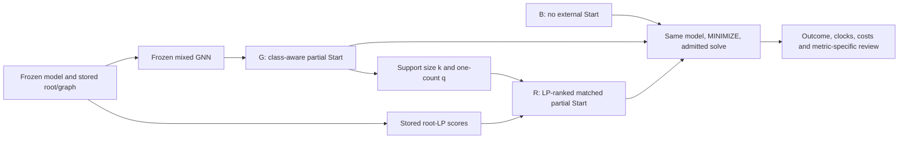

# MVP2 R3 — methods, data and frozen models

26 October 2026 · R2-D2/R2-D3 · governed by the
[R3 contract](mvp2-r3-contract.md).
This consolidates inspected implementations and existing audits. It neither
repeats their experiments nor independently replays historical training.

## Three methods and their dependencies

| Presentation | Historical method | Input and action | Interpretation |
| --- | --- | --- | --- |
| B — BASE | M0 | Original model, no externally supplied Start | Gurobi internal heuristics remain available |
| R — RELAX | M1 | Binary partial Start ranked from stored optimal root-node relaxation | Matches G's support size and positive count; G-dependent preparation |
| G — GNN-START | M2 | Binary partial Start selected from frozen GNN probabilities | Not variable fixing, a complete feasible solution, or an acceleration guarantee |

Keep parent IDs in a separate column: parent M0 is not method M0.
The [installed binding review](pr86-installed-binding-review.md) and
[start coverage table](../evidence/pr86/bindings-45eab23962f8/start_coverage.csv)
already reconcile the ten-parent variable/start identities. They do not prove
solver acceptance or a complete feasible start.

The source references below are pinned to the inspected integration base.
PR89's installed source is separately frozen; its collection uses the original
PR86 artifacts, not a rerun of the procedures described here.

## Root preparation and graph input

The historical [root capture](https://github.com/unb-lamfo-or-ai-hpc/cfl-gurobi-gnn/blob/e5804a8c6762c2e5f13447e5a16784e5824de801/scripts/evidence/pr86_root_preparation.py#L217)
loads the same model through NativeModel, enforces MINIMIZE, verifies model/
parameter/variable-order identity, and captures cbGetNodeRel at the first
MIPNODE with optimal node status and zero explored-node count. It records the
full ordered vector and terminates that preparation solve. This is not an
independent call to model.relax(), nor a claim to record every root cutting-plane
iteration. That root preparation has already happened and must not be repeated.

The [guidance preparation](https://github.com/unb-lamfo-or-ai-hpc/cfl-gurobi-gnn/blob/e5804a8c6762c2e5f13447e5a16784e5824de801/scripts/evidence/pr86_guidance_preparation.py#L260)
binds the model/root/graph/variable names. Graph features have seven variable,
five constraint and one edge channel; the root vector is checked against
variable feature channel 6. The model receives graph features and the binary
mask. The existing graph encoder also reads reference labels for its separate
feasibility audit; the forward/selection path does not use those target values.
This qualified implementation statement does not erase historical test exposure.

## Exact selection rules and pseudocode

Source: [pr58_guidance.py](https://github.com/unb-lamfo-or-ai-hpc/cfl-gurobi-gnn/blob/e5804a8c6762c2e5f13447e5a16784e5824de801/src/cfl_gnn/experiments/pr58_guidance.py),
reused by PR86, with fraction 0.10 and absolute cap 20,000.
Let n be the number of eligible binary variables, p_i their frozen probabilities,
tau the validation-selected threshold and y_i = 1[p_i >= tau].
The requested budget is K = min(n, 20000, max(1, floor(0.10 n))).

```text
G:
  validate finite probabilities in [0,1], unique variable names and binary y_i
  positives := variables with y_i=1, sorted by (-p_i, name)
  if positives is empty: abstain; return empty Start, k=0, q=0
  take first min(K, number of positives) positives, assign value 1
  fill remaining K slots from y_i=0, sorted by (-(1-p_i), name), assign 0
  k := supplied assignment count; q := supplied-one count; hash assignments

R:
  validate stored root values and binary-variable identity
  s_i := clip(root_value_i, 0, 1)
  take q highest s_i, tie-break by name, assign 1
  among remaining variables, take k-q lowest s_i, tie-break by name, assign 0
  hash assignments; if k=0, return empty/abstained guidance

B/R/G solve:
  load a fresh copy of the same model and enforce the admitted parameter map
  B: supply no external Start
  R/G: use the already-bound stored partial assignments
  leave all unselected variables unspecified; preserve every original bound
  check model signature and original variable identity
  execute only the admitted historical solve; record outcome separately
```

This is descriptive pseudocode, not a runnable launcher or permission to solve.
The G rule prioritizes predicted positives before filling with confident zeros.
R uses clipped LP scores and shares (k,q), not necessarily variable indices.
Its LP ranking cannot be credited as a neural-independent preparation pipeline.
Selection records contain confidence/priority metadata; that alone is not proof
that a solver hint or branch-priority parameter was applied.

For the six easy parents, k is 14,520–14,880 (10%); for four medium parents,
k=20,000 (about 1.68–1.74%), according to the existing coverage table.
Do not describe medium starts as covering 10% of their binary variables.

## Solver boundary and preparation costs

The inspected [PR86 solver](https://github.com/unb-lamfo-or-ai-hpc/cfl-gurobi-gnn/blob/e5804a8c6762c2e5f13447e5a16784e5824de801/scripts/evidence/pr86_solver.py#L31)
requires the admitted cell/method/hash and verified preselected assignments,
then checks that the mathematical signature is unchanged. Selected values must
respect original variable bounds. Native Start is supplied for selected
variables and GRB.UNDEFINED is retained elsewhere; B has no external start.
Start application is distinct from acceptance, repair, first incumbent and
final solver status. Gurobi's [Start attribute documentation](https://docs.gurobi.com/projects/optimizer/en/current/reference/attributes/variable.html#attr:Start)
allows partially specified starts and describes solver completion attempts;
the API does not make a partial prediction a feasibility certificate.



Root/graph preparation supports G and R. Charge the neural-dependent matching
cost to R as well; avoid counting the shared preparation twice at campaign
level. PR86 [job3521](pr86-job3521-review-and-main-budget.md) records measured
preparation. Its seven-use allocation in PR86 and five-new-cap allocation in
PR89 are different stated scenarios, not fresh cold measurements.
Training cost is separate from application/preparation and solver cost.

## Dataset, labels and evaluation units

| Population / partition | Easy | Medium | Hard | Total |
| --- | ---: | ---: | ---: | ---: |
| Candidate population | 30 | 30 | 30 | 90 |
| Admitted cohort | 30 | 24 | 0 | 54 |
| Train | 18 | 16 | 0 | 34 |
| Validation | 6 | 4 | 0 | 10 |
| Historically exposed test | 6 | 4 | 0 | 10 |

The 54-parent admission uses historical label quality, not random sampling.
PR80 validated 54/54, not 39. The ten test parents are F0/F3/F6/F14/F27/F29 and
M0/M4/M7/M12. M13/M26 remain limited excluded canonical training cases; their
inspection did not create independent test cases.
Preserve canonical parent partitions and ancestry. Parent is the experimental
unit; methods/caps/seeds/binary variables do not increase the independent n.

Primary PR86 analysis uses 150 seed42 rows (90 easy, 60 medium); preserve all
210 records and retain 60 seed43/44 rows as history. The
[existing main summary](../evidence/methodology-20261019/summary.json)
reports 97 terminal targets and 53 censures, including 30 numerically sensitive
M4/M12 rows. These are solver-reported targets, not 97 exact optima.

## Model/checkpoint identity

The [PR85 checkpoint table](../evidence/e0/pr85/checkpoints.csv),
[PR85 closure](pr85-closure.md) and
[PR86 preparation receipt](../evidence/pr86/job3521/public_return.json)
bind the following chains. No weights are deserialized in this consolidation.

| Field | Historical easy-only reference | Historical mixed CPU reference |
| --- | --- | --- |
| Checkpoint SHA256 | `86e0fb9cf92e6a5d30aaa432caa4074b7e0d2bb22b344cdcbd9be7ed81279cf8` | `a1868134028694e0f807b5627100a77fcd1dc41e6c884b176290caee253a4028` |
| Training plan SHA256 | `cbf0fe92b07aa79de97b9ac616a64178534156b58224fd43ae8494b9d54839ae` | `07c3377c20ef49c0ad3ae33a6b57d9dd70f92fc48a32f5f80c25b5cb32aa5da4` |
| Report SHA256 | `87e21c55db85b038bb06800be10633bd8b479f49c405a9388f03bf62bd87626f` | `974236918746711d044e2c0111a1e145d9487b27e20e7953cda6b63058ef3822` |
| Threshold | 0.9975354671478271 | 0.9991843104362488 |
| Train/validation/test parents | 18/6/6 | 34/10/10 |
| Completed epochs in report | 100 | 100 |
| Positive loss weight, reported | 388.283600 | 1132.975830 |

The configurations
[easy-only](../../configs/training/gasse_easy_transfer_v1.json) and
[mixed](../../configs/training/gasse_pr57_54_v1.json) specify
gasse_v2_alternating_prenorm, two layers, hidden dimension 32, 100 epochs,
patience 100, learning rate 0.001, gradient clipping 1 and seed42.
The historical serial [trainer](https://github.com/unb-lamfo-or-ai-hpc/cfl-gurobi-gnn/blob/e5804a8c6762c2e5f13447e5a16784e5824de801/src/cfl_gnn/training/gasse_reconnected.py#L638)
uses Adam, batch size one and four deterministic parent-balanced draws per
training parent per epoch. It fits class weight on training data and selects
minimum validation weighted BCE, then a validation-F1 threshold.
Do not confuse 100 completed epochs with a selected checkpoint epoch.
The selected historical epoch is not newly extracted here.

[Versioned prenormalization](../../src/cfl_gnn/models/gasse_calibrated.py)
fits population moments from all training graphs in deterministic index order,
alternating constraint/variable message sides; validation/test are excluded
from that fitting path. This and the reported training-only fit are documentary
attestations, not an independent replay of the historical fit. Existing
plan-summary role/hash issues in the checkpoint audit remain disclosed.
Checkpoint hashes and audited selected identities do not repair every old
summary, prove untouched testing, or independently rescore PR-AUC/calibration.

PR87 is a distinct matched-work serial1GPU/DDP4 experiment, with global batch
four, 100 epochs, 13,600 presentations and 3,400 updates per arm. Its selected
epochs 99/92 and newer weights do not replace the CPU checkpoint.
[Completed-pair review](pr87-completed-pair-review.md) reports 2.167x loop/
1.831x job speedup with F1-macro loss 0.032468 and increased assigned GPU-h.
Retain that negative quality observation; no corrective training is implied.

## Scope of the consolidation

Source reading and cross-reference reconciliation complete the description,
not new numerical certification. Preserve M4/M12 limits, missing measurements,
raw eligibility flags and historically exposed tests.
Independent generalization, causal benefit of class-aware selection, robust
multiseed conclusions and cold whole-job end-to-end savings remain unproved.
The [evidence index](mvp2-r3-evidence-index.json) records exact source identities.
