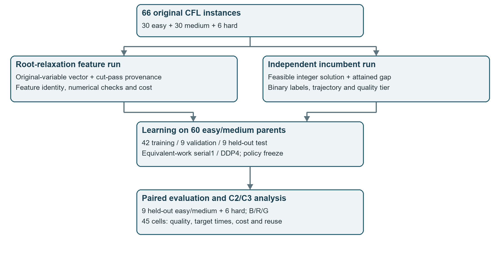
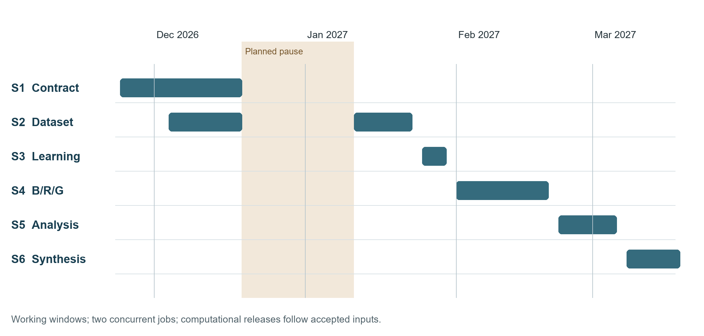

# 1. Research context and objectives

MVP 3.0 investigates how learned partial warm starts influence the solution of mixed-integer network optimisation problems. The study combines an explicit mathematical contract, a controlled learning experiment and a paired comparison against the native solver. Its central question is: **under which instance characteristics, solution-quality targets and patterns of reuse does neural guidance provide a computational advantage after its preparation costs are included?**

The exploratory MVP 2.0 study motivates this question through its target-dependent results: early improvements in primal solution quality and later progress towards an optimality certificate describe distinct computational processes. Coauthor review identified the need for stronger labels, a relaxation-based comparator independent of the neural model, a clearer account of solver effort, and a complete separation between preparation and deployment costs. These requirements define the new research design.

The release of Gurobi 14 provides a timely scientific reason to establish a fresh experimental reference. Its new algorithms and revised heuristic behaviour create a different solver context for assessing external guidance. The research team therefore adopts Gurobi 14 as the native reference for MVP 3.0 and will obtain new observations under a common version and parameter contract.[^release] The study evaluates the contribution of guidance within that reference, with implementation, training and optimisation evidence collected through a reproducible pipeline.

Two contributions organise the analysis. **C2 concerns optimisation behaviour:** the relationship between partial Starts, feasible incumbents, primal and dual progress, and search effort at specified quality targets. **C3 concerns computational economics:** the relationship between preparation, deployment time, resource use and the reuse of guidance artifacts. These contributions connect predictive quality to operational outcomes while retaining separate measurements for each dimension.

The objectives are to:

1. Characterise 66 benchmark instances and construct a traceable dataset of root-relaxation features and independently generated feasible labels.
2. Compare serial and distributed GNN training under equivalent global work, with joint reporting of time, resource use and predictive quality.
3. Compare native baseline B, relaxation guidance R and neural guidance G on 15 evaluation instances under paired solver conditions.
4. Explain target-dependent effects through primal/dual trajectories, Start processing and search observations.
5. Estimate end-to-end costs and conditional amortisation thresholds for clearly defined reuse scenarios.

[^release]: Gurobi Optimization, *Gurobi releases version 14.0 with major performance advances*, https://www.gurobi.com/company/newsroom/gurobi-releases-version-14.0-with-major-performance-advances-to-expand-what%E2%80%99s-possible-with-optimization; version-specific changes: https://docs.gurobi.com/projects/optimizer/en/14.0/reference/releasenotes/changes.html.

# 2. Research methods and models

## 2.1. Mathematical object and unit of analysis

The experimental unit is an original CFL instance from MILPBench.[^milpbench] Presentation aliases are E for easy, M for medium and H for hard. The manifest retains each original benchmark identifier alongside its alias. A single original instance remains one experimental unit throughout graph construction, training partitions and solver evaluation.

The study writes the original mixed-integer linear problem in the following general form:

$$
\begin{aligned}
\min_{x}\quad & c^{\mathsf T}x+c_0,\\
\text{subject to}\quad & A x\mathrel{\bowtie}b,\\
& \ell\le x\le u,\\
& x_j\in\mathbb Z\quad (j\in\mathcal I).
\end{aligned}
\tag{1}
$$

Here, each row retains its original inequality or equality sense, represented collectively by the symbol $\bowtie$. The sets of continuous and integer variables, coefficients, bounds and constraints define the same feasible region for B, R and G. The objective convention is minimisation.[^sense] The scientific comparison varies only the externally supplied partial Start.

An independent numerical audit evaluates a reported solution against the original rows, variable bounds and integrality requirements. It also recomputes the objective, including the objective constant. The audit records residuals and explicit tolerances, giving each metric a qualification status. This provides an interpretable connection between the solver report and the mathematical instance.

[^milpbench]: Original benchmark repository: https://github.com/thuiar/MILPBench. The selected population contains 30 easy, 30 medium and six hard CFL instances.
[^sense]: The project corrects the erroneous MAXIMIZE declaration found in the source LP files by applying MINIMIZE at model load. The original maximisation convention produced trivial solutions in the project's earlier analysis. Stored source files retain their identities, and each run records both declared and effective objective sense.

## 2.2. Two independent preparation runs per instance

Each instance has two preparation objectives. The **feature run** obtains a continuous root-relaxation vector. The **label run** obtains an integer feasible incumbent and measures its quality. The runs use fresh model objects and separate output artifacts. Their common instance identity connects the resulting features and labels.

This separation has a direct methodological purpose. The root-relaxation vector describes information available before guidance is constructed. The incumbent supplies supervised target values and an independently recorded quality level. At deployment, R and G receive their permitted features; the label record serves training, qualification and analysis.

Figure 1 shows how these two preparation branches enter the learning and solver stages.

{width=98%}

The upper branches provide different artifacts for the same original instance. The lower comparison uses the frozen predictor and policies, giving all three methods the same original MILP and evaluation budget.

### Root-relaxation feature run

The continuous relaxation of equation (1), obtained by allowing integer variables to take continuous values within their original bounds, is denoted by $\mathcal L_0$. A vector observed during the solver's root-node processing is denoted by $\widehat x^{\mathrm{root}}$, together with its event identifier and cut-pass provenance.

The feature profile uses Presolve=0, Heuristics=0, Method=-1, Threads=0, ConcurrentMIP=1 and Seed=42. The maximum optimisation allowance is 28,800 seconds, within a 12-hour job. A successful complete capture ends this run as soon as the required artifact has been recorded. The callback observes MIPNODE events, verifies OPTIMAL status and zero processed nodes, and requests relaxation values for the complete ordered list of original variables.[^callback]

The callback ledger records every root-event ordinal and its status. The first root MIPNODE event identifies the pre-cut observation described by Gurobi; subsequent root events identify successive cut passes. A vector from the first event with OPTIMAL status receives its actual ordinal. The artifact is designated as an observation of $\mathcal L_0$ when the event provenance and numerical checks support that interpretation. Later valid observations retain their own cut-pass identity. This makes feature semantics explicit across instances.

Presolve and cutting planes have separate roles. Presolve=0 preserves the original model representation for this feature profile; the event ledger identifies the cutting-plane state. Heuristics concern integer feasible solutions, whereas this run's target is a continuous vector. The feature artifact records the complete effective parameter map, including cut settings and version.[^parameters]

Table 1 defines the root-relaxation artifact in reader-oriented terms.

**Table 1. Root-relaxation record.**

| Field | Meaning and example |
| --- | --- |
| Instance identity | Original identifier, alias and stored-file SHA256, such as E12 |
| Ordered variables | Original names and positions; every model variable has one recorded coordinate |
| Values | Finite continuous relaxation values in the same order |
| Capture event | MIPNODE status, root-event ordinal and processed-node count |
| Relaxation provenance | Pre-cut root observation or identified later root cut pass |
| Numerical checks | Bound and row residuals for the applicable continuous system |
| Configuration | Effective parameters, solver version and mathematical signature |
| Computational effort | Load time, capture time, native Work and sampled memory peak |
| Artifact integrity | Shape, variable-order digest, vector digest and final artifact digest |

These fields allow a coauthor to identify what the vector represents and how it was obtained. A missing or incomplete vector receives an explicit feature-availability outcome, preserving its place in the 66-instance population.

[^callback]: Gurobi 14 callback codes and the root cut-pass remarks: https://docs.gurobi.com/projects/optimizer/en/14.0/reference/numericcodes/callbacks.html#additional-remarks. Python callback relaxation access: https://docs.gurobi.com/projects/optimizer/en/14.0/reference/python/model.html#cbGetNodeRel.
[^parameters]: Gurobi 14 parameter definitions, including Presolve, Heuristics, Method, Threads, MIPFocus, ConcurrentMIP, Seed, TimeLimit and MIPGap: https://docs.gurobi.com/projects/optimizer/en/14.0/reference/parameters.html.

### Incumbent and label run

The second preparation run solves the original MILP using native Gurobi 14, automatic presolve and LP-method selection, default feasibility heuristics, Threads=0, ConcurrentMIP=1 and Seed=42. Its target is MIP gap $\leq0.01\%$, with TimeLimit=28,800 seconds and a 12-hour job.

The record includes the first feasible incumbent, improving incumbent events, dual-bound progress, final incumbent and gap, and the first observed times at gaps of 10%, 5%, 1% and 0.01%. These targets describe a single solve trajectory. The final gap and censoring status accompany every instance, including those that end at an intermediate quality level.

For a binary variable $j$, the supervised label is the audited incumbent value $y_j\in\{0,1\}$. Labels receive a reference-quality tier: terminal-target attained, feasible intermediate-gap incumbent, or unavailable audited incumbent. The proposed primary training dataset uses the terminal-target tier. An eligibility report for the 60 learning instances quantifies coverage before the split is frozen; any broader label-quality policy is resolved at the dataset acceptance milestone. This gives the target gap an explicit role in supervision quality and sample coverage.

### Gurobi 14 feasibility diagnostics

Gurobi 14 introduces a NoRel tree heuristic and a PDHG-based MIP heuristic. MIPFocus=1 activates a feasibility-oriented strategy, including the new NoRel tree mechanism. The release also makes SolutionLimit=1 a stopping rule rather than an implicit activation of extra heuristics.[^changes] These features motivate a clearly labelled **feasibility diagnostic** for a hard instance whose direct run provides inadequate incumbent information.

The diagnostic proposal uses MIPFocus=1 on a separate original-model run, with default presolve and heuristics and the same maximum time allowance. Its purpose is incumbent discovery and label qualification. The principal B/R/G comparison retains one common native strategy, MIPFocus=0. This separates a targeted preparation remedy from the paired assessment of external guidance. The diagnostic register specifies the exact parameters, trigger, instance and budget before a run is released. The hard-instance contingency envelope contains at most six such additional runs; section 4 accounts for it separately.

[^changes]: Gurobi 14 release notes, sections *NoRel tree heuristic*, *PDHG-based MIP heuristic* and the SolutionLimit change: https://docs.gurobi.com/projects/optimizer/en/14.0/reference/releasenotes/changes.html. The proposed diagnostic investigates feasible incumbents; the root-relaxation feature profile is defined independently.

## 2.3. GNN and equivalent-work serial/DDP training

The GNN adapts the bipartite variable-constraint representation developed by Gasse et al. (2019) [1]. Their original application learns branching decisions; the present study uses the representation to predict incumbent binary values for partial Starts. Variable, constraint and edge inputs have dimensions 7, 5 and 1. The reference architecture uses two alternating message-passing layers, hidden width 32 and fitted prenormalisation buffers. Appendix A states the learning operations and audit boundaries.

Training uses 42 easy/medium parents, validation uses nine, and the held-out easy/medium test set contains nine. Normalisation and class weights are estimated from the training parents. Validation determines the checkpoint, classification threshold and deployed predictor. The six hard instances form a separate size-transfer evaluation population.

The planned training comparison uses one V100 for serial training and four V100s for distributed data parallel training on the same GPU model. DDP synchronises gradients across workers; Li et al. (2020) [2] describe this execution model. Both arms start from the same parameters and prenormalisation state and consume the same ordered global batches. The loss is the mean of four per-graph weighted binary cross-entropy values. A global batch contains four graphs, with 100 epochs and four deterministic presentations per training parent per epoch. This gives 168 presentations and 42 optimiser updates per epoch, or 16,800 presentations and 4,200 updates per arm.

Adam uses learning rate 0.001 and gradient clipping norm 1.0. FP32 arithmetic and the recorded precision settings define the reference. Serial microbatch accumulation and DDP gradient averaging reproduce the same global objective, with tests covering unequal graph sizes and the final partial batch. Parent-level storage shards and bounded graph loading control host and device memory while preserving each graph's mathematical identity.

Each arm records training-loop time, training plus validation/checkpoint time, full-job elapsed time, GPU-hours, host/device memory and predictive metrics. The selected checkpoint minimises mean parent validation loss, with the earliest epoch resolving a tie. The proposed deployed predictor is the arm with lower selected validation loss, followed by the serial arm in an exact tie. The held-out solver outcomes then evaluate that single frozen predictor.

## 2.4. Baseline, independent relaxation guidance and neural guidance

Table 2 identifies the three solver methods. Every method solves the original minimisation problem with fresh model state and unchanged variable domains.

**Table 2. Paired methods.**

| Method | External information | Scientific role |
| --- | --- | --- |
| B: native baseline | Original MILP and native solver state | Reference performance |
| R: relaxation guidance | Qualified root-relaxation vector | Independent non-neural guidance comparator |
| G: neural guidance | Root features and frozen GNN predictions | Learned partial guidance |

The proposed R policy rounds qualified binary relaxation values towards their nearest integer and ranks them by confidence $|2\widehat x_j^{\mathrm{root}}-1|$. The proposed G policy uses the frozen model probability $p_j$ and ranks assignments by $|2p_j-1|$. A shared policy template selects values at or below 0.1 or at or above 0.9, up to 10% of the instance's binary variables, with original variable order resolving ties. These numerical support settings are explicit **coauthor-review proposals**, frozen at S3 before held-out evaluation. Each method's actual support size is recorded.

R derives its assignments and support from the relaxation and its own fixed rule. G derives its assignments and support from neural probabilities. This makes R operationally independent of G and gives the third method a clear role: it measures whether root-relaxation guidance alone already provides the benefit attributed to the learned transformation. B/G is the primary contrast; R/B and G/R explain the added value of each preparation strategy.

For method $m$, a partial Start assigns values on a support $\mathcal S_m$:

$$
x_j^{\mathrm{Start},m}=s_j\quad(j\in\mathcal S_m),
\qquad x_j^{\mathrm{Start},m}=\mathrm{UNDEFINED}\quad(j\notin\mathcal S_m).
\tag{2}
$$

These are solution suggestions supplied through the Start attribute. The main solve retains the original feasible region. Table 3 separates the evidence used to interpret them.[^starts]

**Table 3. Start evidence and interpretation.**

| Evidence | Interpretation |
| --- | --- |
| Submitted | Assignment names, values, support and artifact digest are recorded |
| Structurally valid | Values satisfy the selected variables' domains and bounds |
| Feasible completion | A full audited solution satisfies every supplied assignment |
| Solver processing | A native log message or recorded event describes Start processing |
| Incumbent contribution | A solver report attributes a feasible candidate to the Start |
| Computational contribution | Paired time/quality and preparation-cost analyses quantify the result |

A complete infeasible candidate can be rejected during Start processing. For a partial candidate, Gurobi can attempt to complete the unspecified values, and that attempt can end without an accepted incumbent. The native log documents the observed outcome. A message that the Start produced no new incumbent has several possible explanations, including an incumbent of equal or better quality already found by the solver. The report therefore preserves the specific processing message and any attributed feasible candidate.

A targeted completion diagnostic copies the original model, fixes the selected variables to their submitted values in that diagnostic copy and searches for a full feasible solution. An audited feasible point establishes completability; a conclusive infeasibility status establishes failure of that proposed extension; a time-limited search with no solution records an unresolved diagnostic. The principal B/R/G model remains the original MILP, and diagnostic costs have a separate ledger. Appendix B gives the decision sequence.

[^starts]: Gurobi 14 Start attribute and guidance on incomplete or unsuccessful MIP Starts: https://docs.gurobi.com/projects/optimizer/en/14.0/reference/attributes/variable.html#start. The OptAI 101 warm-start course provides the didactic starting point; the versioned reference manual defines the implementation semantics.

## 2.5. Benders as a conditional hard-instance method

Benders decomposition separates a large structured problem into a master problem and smaller subproblems. The master proposes the complicating decisions; subproblems evaluate the remaining decisions and return feasibility or optimality cuts. Haq, Chaerani and Triska (2025) [3] review applications to robust facility-location MILPs and provide relevant context for this conditional avenue.

The primary procedure for all 66 instances is direct Gurobi optimisation of the original MILP. Benders is reserved for H0, H5, H10, H15, H20 and H25 when a documented direct-run limitation prevents a complete relaxation artifact or a sufficiently qualified incumbent, or when measured memory use exceeds the selected envelope. A per-instance design will then establish the variable partition, recourse properties, cut validity and objective equivalence.

A Benders-produced feasible solution receives provenance BENDERS and the same original-model numerical audit used for other label candidates. Root-relaxation features retain their original-MILP provenance. Appendix C defines the decomposition contract and the proposed review package for this conditional branch.

# 3. Experimental design and computing resources

## 3.1. Population, partitions and evaluation scope

Table 4 states the population and the role of each group. The six hard identifiers are H0, H5, H10, H15, H20 and H25.

**Table 4. Instance population and research roles.**

| Group | Count | Role |
| --- | ---: | --- |
| Easy | 30 | Learning partitions and structural characterisation |
| Medium | 30 | Learning partitions and structural characterisation |
| Hard | 6 | Direct characterisation and size-transfer evaluation |
| Learning population | 60 | 42 training, nine validation and nine test parents |
| Final paired evaluation | 15 | Nine easy/medium test parents and six hard parents |

The proposed balanced split contains 21 easy and 21 medium training parents, five easy and four medium validation parents, and four easy and five medium test parents. S1 freezes deterministic parent identifiers through a seed-42, class-stratified procedure, together with a manifest digest. S2 validates feature and label coverage against that planned population. This split allocation is a coauthor-review proposal within the agreed 42/9/9 totals.

All fitted transformations and learning decisions use the training or validation partition associated with their stated role. The hard population evaluates transfer to larger instances, with its structural and historical exposure described explicitly. Results for represented easy/medium classes and results for hard instances are reported as separate cohorts.

Each evaluation parent has three fresh main solves, one for each method, giving $15\times3=45$ cells. Preparation has 66 root-relaxation runs and 66 incumbent runs. The planned primary optimisation ledger therefore has $66+66+45=177$ calls. A common solve trajectory supplies the four target-gap observations for each cell.

## 3.2. Common solver profiles and paired execution

Table 5 presents the effective parameter profiles. Each release records all effective defaults as well as the explicitly selected values.

**Table 5. Solver profiles.**

| Setting | Root-relaxation feature | Incumbents and main B/R/G |
| --- | --- | --- |
| Objective sense | MINIMIZE | MINIMIZE |
| Presolve | 0 | -1, automatic |
| Heuristics | 0 | 0.05, native default |
| Method / Threads | -1 / 0 | -1 / 0 |
| ConcurrentMIP / Seed | 1 / 42 | 1 / 42 |
| MIPFocus | 0 | 0 |
| Maximum optimisation time | 28,800 seconds | 28,800 seconds |
| Completion record | Complete qualified vector or capture outcome | Gap target 0.0001; attained thresholds and final gap |
| Job walltime | 12 hours | 12 hours |

The separate feasibility diagnostic described in section 2.2 sets MIPFocus=1 for its stated preparation objective. Its identity and budget remain distinct from Table 5's primary profiles. Gurobi runs use CPU-only nodes. The GNN training comparison uses GPU nodes under its own resource plan.

For each parent, B/R/G share the solver version, loaded formulation, machine class, memory allowance, automatic-thread policy, numerical audit and termination criteria. A predeclared blocked order rotates B/R/G positions across instances. At most two jobs run concurrently across the programme, and at most two Gurobi sessions are active. The dispatcher also admits one job per original parent at a time, so paired methods encounter comparable node allocations over successive runs.

The label-generation baseline provides preparation evidence. A fresh B run in the evaluation block supplies the contemporaneous paired reference. The analysis therefore identifies all 177 calls by purpose and maintains a direct link between each evaluation cell and its preparation artifacts.

## 3.3. Partitioning work to manage time and memory

The programme partitions computation by **instance and scientific stage**. Root-relaxation capture, incumbent generation, graph preparation, training and evaluation each have a clear input/output boundary. Separate jobs allow a completed feature artifact to be accepted independently of later incumbent search and preserve an auditable partial result when another stage reaches its limit.

Storage shards contain complete parent graphs and their metadata. Training loads bounded graph batches and writes fitted states and checkpoints at defined milestones. Evaluation loads one original instance per process. Memory supervision measures the complete job scope, while the audit reports process and device measurements separately.

This operational partitioning preserves the original mathematical problem. A decomposition of the mathematical model is the separate conditional Benders route of section 2.5. A high-memory instance is assigned to the larger planned memory class before a paired block begins. Every arm within that block receives the same class. Time-limit censoring, memory termination and infrastructure interruption remain distinct outcomes in the collected ledger.

## 3.4. Exclusive-node resource plan

Table 6 translates the recorded NPAD node topology into the proposed exclusive-node allocations. The Intel nodes have two sockets, 16 physical cores per socket and SMT2: **32 physical cores and 64 logical CPUs**, independently of the 256/512 memory suffix. The resource request uses one task and 64 Slurm CPUs per task for the single-process solver. An exclusive allocation reserves the node; the explicit RAM request defines the job's memory allowance.

**Table 6. Proposed node envelopes.**

| Stage / node class | Physical cores / logical CPUs | Planned RAM | Accelerator / walltime |
| --- | --- | --- | --- |
| Easy/medium solver: intel-256 | 32 / 64; one task; exclusive | 192 GiB | CPU only; 12 h |
| Hard solver: intel-512 | 32 / 64; one task; exclusive | 384 GiB | CPU only; 12 h |
| Serial training: gpu-8-v100 | 32 / 64; exclusive | 192 GiB | One V100 used; 6 h |
| DDP training: gpu-8-v100 | 32 / 64; four ranks; exclusive | 192 GiB | Four V100s used; 6 h |

The controller records approximately 250 and 500 GiB of allocatable memory for the two Intel classes and eight 16-GB V100s per V100 node. Requests in Table 6 retain headroom for the node's operating environment. The scheduler release checks the effective partition, association and per-CPU memory rules for each concrete request. Two simultaneous hard jobs require two exclusive nodes and a combined request of 768 GiB. The two-job admission ceiling applies to training and solver work together.

Threads=0 leaves the solver's thread choice automatic. Gurobi documents a soft ceiling of 32 for that setting.[^threads] The run records the parameter value, environment ThreadLimit, logical affinity, physical sibling mapping, native log header, final native thread-count line, and process CPU-time samples. These distinguish allocation, the solver's reported thread count and measured CPU consumption. Later phase analysis relates each observation to its scope; a full-node reservation is an accounting quantity rather than a measurement of continuously active cores.

The training comparison reports both the GPUs used by the model and exclusive-node occupancy. Serial uses four physical CPU cores for its worker; DDP uses four physical cores per rank. The resulting speedup describes the stated training system. GPU-normalised efficiency and whole-node hours provide complementary resource perspectives.

[^threads]: Gurobi 14 Threads parameter and ThreadLimit environment setting: https://docs.gurobi.com/projects/optimizer/en/14.0/reference/parameters.html#threads. The native log records the thread configuration actually reported by each run.

# 4. Computational budget and schedule model

## 4.1. Primary optimisation envelope

Table 7 counts every primary optimisation call. Each allowance is eight native solver-hours and twelve reserved job-hours. Root-relaxation runs finish once their complete artifact is captured; the eight-hour ceiling also accommodates difficult captures.

**Table 7. Primary optimisation budget.**

| Stage | Calls | Maximum solver-hours | Reserved job-hours |
| --- | ---: | ---: | ---: |
| Root-relaxation features: 66 instances | 66 | 528 | 792 |
| Incumbents and labels: 66 instances | 66 | 528 | 792 |
| Paired evaluation: 15 instances × B/R/G | 45 | 360 | 540 |
| Total primary programme | 177 | 1,416 | 2,124 |
| Conditional hard feasibility diagnostics | Up to 6 | Up to 48 | Up to 72 |

The primary total is a reservation envelope. Actual runtime is collected separately, and each early completion releases the remainder of its allowance. The conditional row belongs to a diagnosed and separately released preparation branch. A Benders branch or additional completion diagnostic receives its own per-instance budget at review.

With 32 physical cores per exclusive Intel node, the primary reservation is 67,968 physical core-hours, or 135,936 logical Slurm CPU-hours. The proposed memory classes allocate 192 GiB to 147 calls and 384 GiB to 30 calls, giving 476,928 GiB-hours at the full twelve-hour reservation. These products express reserved capacity. Measured CPU activity and sampled memory peaks are additional observations.

At the two-job ceiling and strict stage barriers, the 66, 66 and 45 calls require 33, 33 and 23 two-slot waves. Filling every twelve-hour reservation gives 1,068 calendar hours, or 44.5 days of continuously available execution slots. Using the eight-hour optimisation ceilings gives 712 hours, or 29.7 days, before measured stage overhead. These provide two distinct planning scales: reservation occupancy and native optimisation time.

## 4.2. Historically informed working scenario

Historical easy-instance evidence supports a working scenario with substantial early completion. In the qualified seed-42 easy rows of the one-hour study, the 18 B/R/G solves ranged from 41.5 to 311.2 seconds, with median 78.3 seconds, and all reached the terminal target.[^easyhistory] These observations describe six easy instances under an earlier solver/resource context. They serve as a budgeting anchor rather than as new MVP3 performance measurements.

Table 8 uses a deliberately broad **one-hour easy-instance allowance** and eight hours for medium/hard calls. The allowance is a scheduling scenario applied to each relevant preparation/evaluation call; its empirical basis is strongest for the historical main easy solves. A quarter-hour per call represents a stated allowance for load, audit and export. The release recalibrates the scenario from the first admitted stage measurements.

**Table 8. Working timing scenario.**

| Stage | Easy calls | Medium/hard calls | Optimisation-hours in scenario |
| --- | ---: | ---: | ---: |
| Root-relaxation features | 30 | 36 | 318 |
| Incumbents and labels | 30 | 36 | 318 |
| Paired evaluation: proposed four-easy/five-medium test split | 12 | 33 | 276 |
| Total | 72 | 105 | 912 |

Including the quarter-hour overhead allowance gives 956.25 aggregate job-hours. Two continuously available slots correspond to approximately 478 calendar hours, or 19.9 days, with additional allowance for stage barriers and scheduling. This scenario makes the expected contribution of short easy runs explicit while retaining the full per-run ceiling in the execution contract. The schedule in section 7 includes contingency around these stage estimates.

[^easyhistory]: Project's reconciled one-hour results, 18 seed-42 easy B/R/G rows from six parents: https://github.com/unb-lamfo-or-ai-hpc/cfl-gurobi-gnn/blob/61ba422c147c3a3d9ae04b49f1607ed5fca4d0e1/docs/evidence/pr94/final-20261105/cells.csv. Historic F-prefixed identifiers are presented as E aliases in MVP3. The raw historical identities remain intact.

## 4.3. Training and non-solver preparation

The historical equivalent-work training pair completed 3,400 updates per arm in 2,021 seconds for serial and 1,104 seconds for DDP4. Allocated GPU use was 0.5614 and 1.2267 GPU-hours, respectively.[^traininghistory] Table 9 distinguishes this planning anchor from the proposed new training envelope.

**Table 9. Training budget.**

| Quantity | Historical pair | MVP3 planning value |
| --- | --- | --- |
| Training parents / updates per arm | 34 / 3,400 | 42 / 4,200 |
| Full-job serial / DDP4 elapsed | 33.7 / 18.4 min | Simple work-ratio scenario: 41.6 / 22.7 min |
| Job walltime cap per arm | Recorded historical execution | 6 h per arm |
| GPU use at walltime caps | Historical measured pair: 1.7881 GPU-h | Requested-use envelope: 6 + 4×6 = 30 GPU-h |
| Exclusive-node occupancy | Separate historical allocation | Two sequential jobs; up to 12 node-h |

The work-ratio scenario multiplies historical elapsed time by $42/34$, holding graph cost and per-update behaviour constant as an explicit modelling assumption. New graph sizes, I/O and runtime behaviour will determine actual training time. The six-hour caps provide a considerably broader release envelope. On an eight-GPU exclusive node, twelve node-hours represent 96 GPU-device-slot-hours of occupied capacity; allocated billing is taken from the scheduler record, alongside the model's requested GPU use.

The proposed CPU-only artifact allowance is 12 job-hours for graph/dataset assembly, eight job-hours for inference and Start assembly, and four job-hours for reconciliation/export. These are engineering estimates reviewed at S1 and reconciled with measured artifact sizes at S2. Their total is 24 job-hours outside the optimisation ledger. Streaming construction and per-parent outputs make it possible to compare measured throughput with this allowance.

The primary programme thus has three explicit ledgers: 2,124 CPU-solver reserved job-hours, 24 CPU artifact-processing job-hours, and 12 exclusive GPU-node hours. The hard feasibility contingency adds up to 72 CPU job-hours after its trigger and release decision. Storage demand is estimated from the 66-instance structural manifest and the serialized graph/vector layouts before full artifact generation.

[^traininghistory]: Reconciled equivalent-work training records: https://github.com/unb-lamfo-or-ai-hpc/cfl-gurobi-gnn/blob/61ba422c147c3a3d9ae04b49f1607ed5fca4d0e1/docs/evidence/pr87/jobs3673-3674/summary.csv and the companion timings table. They provide a workload/budget anchor for the proposed training pair.

# 5. Data collection and evidence structure

## 5.1. Instance characterisation

The instance catalogue combines structural information with independently recorded solve outcomes. Table 10 illustrates the fields and their scientific uses.

**Table 10. Instance-level catalogue.**

| Field group | Examples | Analytical use |
| --- | --- | --- |
| Identity | Original ID, E/M/H alias, origin, stored-file hash | Traceability and parent-level linkage |
| Mathematical size | Rows, columns, binary/integer/continuous counts, nonzeros | Structural difficulty and graph sizing |
| Numerical profile | Coefficient ranges, bounds, objective constant and sense | Audit interpretation and numerical stability |
| Graph structure | Variable/constraint nodes, edges, feature shapes, serialized bytes | Memory and preparation-cost analysis |
| Root-relaxation outcome | Event provenance, coverage, time, Work and residuals | Feature availability and root effort |
| Incumbent outcome | First incumbent, final objective/bound/gap, target times | Label-quality tier and direct-solve difficulty |
| Analysis role | Training, validation, held-out test or hard transfer | Partition-specific eligibility |

Structural descriptors are determined before guidance outcomes are inspected. Descriptive strata based on native-baseline difficulty retain their stated origin. Feature availability, incumbent availability and numerical validity receive separate fields, so the analysis can identify the exact denominator of each reported result.

## 5.2. Run records and event trajectories

A run record joins the instance, stage, method, solver seed, source revision, environment identity, effective parameters and input/output artifacts. It includes the scheduler allocation, native log, termination cause and independent audit. The unique key is instance/stage/method/seed/attempt; a preserved attempt identifier distinguishes an interrupted run from any separately approved replacement.

Table 11 gives the principal time-series observations. All timestamps state their origin: native runtime, callback elapsed time, or external process clock.

**Table 11. Trajectory observations.**

| Observation | Recorded values | Interpretation |
| --- | --- | --- |
| Feasible candidate event | Time, objective, vector or artifact reference, audit status | Candidate solution evidence |
| Best incumbent update | Time and best qualified primal value | Primal improvement |
| Dual-bound update | Time and best reported bound, numerical status | Progress of the optimality proof |
| Threshold crossing | Target, first observed time and follow-up endpoint | Attainment and target-specific censoring |
| Search effort | Nodes, iterations and native Work where available | Computational effort beyond seconds |
| Start processing | Native message, support digest, attributed candidate | Evidence about proposed guidance |
| Resource sample | Process/cgroup memory and CPU activity; GPU scope for training | Memory envelope and observed use |

The callback retains bounded event buffers and writes durable summaries at controlled points. Improving candidate solutions are linked to their stored vectors where an independent point-specific audit is intended. The final incumbent always receives its own audit. Each reported audit identifies the exact vector examined, making final-solution and intermediate-event evidence distinguishable.

## 5.3. Completion, censoring and interruption

Each run ends with one of the recorded scientific or operational outcomes: target attained, time limit, memory termination, numerical failure, callback failure, infrastructure interruption, or successful early feature capture. Target-specific fields then record whether 10%, 5%, 1% and 0.01% were observed before that endpoint.

Time-limit censoring represents valid follow-up that ended before a specified target was reached. Infrastructure interruptions and invalid numerical evidence receive their own categories. A replacement run, when specifically released, has a new attempt identifier and retains the original attempt in the reconciliation ledger. This preserves the complete observation history while allowing metric-specific eligibility decisions.

# 6. Data analysis and interpretation

## 6.1. Reconciliation and numerical qualification

Analysis starts with the expected 66 feature records, 66 label records and 45 evaluation cells. The reconciler identifies missing, duplicated and terminal records, matches hashes and source/resource contracts, and associates each trajectory with its numerical audits. The output is a complete instance-by-stage ledger with a reason for each eligibility status.

The audit examines row feasibility, bounds, integrality and objective consistency. A metric-specific qualification rule then determines whether a record contributes to primal-quality comparison, target-time comparison, label construction or descriptive resource analysis. For example, an audited final incumbent can support final primal quality while a missing intermediate vector restricts the qualification of that particular earlier event. The report preserves both conclusions.

For finite qualified primal and dual values, the relative gap is

$$
g(t)=\frac{|z_P(t)-z_D(t)|}{|z_P(t)|}.
\tag{3}
$$

A zero primal value with an identical dual value has zero gap; a zero primal value with a distinct dual value follows the solver's infinite-gap convention. A run without a feasible incumbent has an explicit solution-availability status. The analytical dataset retains these cases as categories alongside the numeric gap field.

## 6.2. Target-time comparisons and standardised ratios

For target $\tau$, the first qualified observed attainment time is

$$
T_m(\tau)=\inf\{t\in\mathcal T_m:g_m(t)\le\tau\},
\qquad \tau\in\{0.10,0.05,0.01,0.0001\},
\tag{4}
$$

where $\mathcal T_m$ is the recorded observation schedule for method $m$. This definition makes callback sampling resolution part of the measurement. A valid run that ends before attainment contributes right-censored follow-up at its actual endpoint.

All method-comparison time ratios use the guided method in the numerator and its named comparator in the denominator:

$$
\rho_{G/B}(\tau)=\frac{T_G(\tau)}{T_B(\tau)},\qquad
\rho_{R/B}(\tau)=\frac{T_R(\tau)}{T_B(\tau)},\qquad
\rho_{G/R}(\tau)=\frac{T_G(\tau)}{T_R(\tau)}.
\tag{5}
$$

For $\rho_{G/B}$, values below one favour G. For $\rho_{R/B}$ and $\rho_{G/R}$, values below one favour the numerator method. Figures and tables state the formula, target and clock in their caption or column definition. The primary B/G communication consistently uses $T_G/T_B$.

Table 12 explains how attainment enters the paired analysis. A numeric ratio is calculated for common target attainment with positive comparable times. Other pair outcomes have their own visible counts.

**Table 12. Target-specific paired outcomes.**

| Outcome | Reported result |
| --- | --- |
| Both methods attain the same target | Time ratio, paired time difference and individual times |
| G alone attains the target | G-only attainment and comparator follow-up |
| B alone attains the target | B-only attainment and G follow-up |
| Both have valid censored follow-up | Two censures and final quality at a common observed horizon |
| One record is numerically or operationally ineligible | Reason and metric-specific denominator |

For illustration, a G time of 120 seconds and B time of 180 seconds gives $T_G/T_B=0.667$. If B has valid follow-up to 28,800 seconds with no target attainment, the result is G-only attainment rather than a numeric observed time ratio. These examples show the reporting rule, rather than additional experimental results.

The main summaries are per-instance trajectories, target-specific attainment counts, medians and distributions of qualified paired ratios. Geometric means, where reported, identify their exact eligible cohort, target and clock. Easy/medium test and hard-transfer results have separate summaries. The inferential unit remains the original instance; seed42 describes one prespecified solver configuration.

## 6.3. Primal progress, dual progress and C2

At common observed horizons, the analysis reports feasible-solution availability, audited primal objective, reported dual bound and gap as separate outcomes. For minimisation, a lower feasible objective represents better primal progress; a stronger lower bound represents progress of the proof. Target attainment combines both and can change its ordering across 10%, 5%, 1% and 0.01%.

The explanatory analysis aligns Start-processing messages, first incumbents, presolve observations, root-relaxation work, node counts and available LP iteration measures. It asks whether an early G advantage coincides with earlier primal progress, whether later target times reflect dual closure, and how much search effort accompanies each trajectory. Phase observations are labelled as native, callback-derived or externally sampled, with overlapping intervals identified explicitly.

This evidence supports an association-based interpretation of search behaviour. The controlled treatment is the method's complete guidance procedure, including preparation and its fixed policy. The report presents that scope alongside any interpretation of Start influence, feature quality or label quality.

## 6.4. End-to-end costs, reuse and C3

The native solver clock measures the main optimisation call. The end-to-end clock includes the required model loading, relaxation feature, graph construction and transfer, inference, Start assembly, optimisation, audit and export. A timing hierarchy identifies nested regions before additive cost tables are produced.

For method $m$, define reusable preparation $P_m$ and recurring per-use cost $q_m$ under a stated quality target and clock. The reuse model is

$$
C_m(k)=P_m+kq_m,\qquad k\in\mathbb N,\ k\ge1.
\tag{6}
$$

For positive recurring saving $d=q_B-q_G$ and nonnegative extra initial preparation $\Delta P=P_G-P_B$, the conditional break-even count is

$$
k_{\mathrm{BE}}=\max\!\left(1,\left\lceil\frac{\Delta P}{d}\right\rceil\right).
\tag{7}
$$

The calculation states which features, graph, prediction or trained model remain reusable and which per-use operations recur. When recurring G cost equals or exceeds recurring B cost, the report gives the direct cost inequality and the resulting absence of an amortisation threshold for positive extra preparation. Training cost appears as a separate line and can be included in a clearly stated system-lifetime scenario.

For example, extra preparation of 600 seconds and an observed recurring saving of 100 seconds gives a conditional threshold of six uses under those assumptions. Reusing a model after a change to coefficients, feature construction or predictor policy requires a new identity and cost assessment. The study reports calculated scenarios as conditional economics, with observed uses and hypothetical uses explicitly identified.

## 6.5. Predictive quality, training efficiency and scale

Predictive reporting includes parent-level precision, recall, F1, average precision and a separately defined trapezoidal PR-AUC. Confusion counts and the weighting of pooled metrics accompany these summaries. Predictive quality is then compared descriptively with Start support, feasibility evidence and solver outcomes.

For equivalent training work, training-system speedup and GPU-normalised efficiency are

$$
S_{\mathrm{train}}=\frac{T_{1}}{T_{4}},\qquad
E_{\mathrm{GPU}}=\frac{S_{\mathrm{train}}}{4}.
\tag{8}
$$

The notation distinguishes the conventional resource-scaling speedup from the method-comparison ratio $\rho_{G/B}$. Training-loop, full-job and exclusive-node clocks each receive their own result. CPU resources, GPUs used and node occupancy make the resource scope explicit.

Computational performance comprises elapsed time, memory, attained quality and preparation effort. Strong scaling holds the work fixed while resources increase; weak scaling increases work and resources together at approximately fixed work per resource. Solving larger original instances at a fixed resource policy is problem-size scale-up. Throughput is completed defined work per unit elapsed time under a stated resource scope. The planned serial/DDP pair examines equivalent-work training-system scaling; the B/R/G campaign examines guidance and instance-size effects under its fixed automatic-thread policy.

The analytical pipeline produces an instance manifest, qualified event table, target-attainment table, paired-comparison table, training-quality table and cost/reuse table. Figure and table generation reads these reconciled datasets, providing a traceable path from collected records to C2 and C3 conclusions.

# 7. Development Sprints, PRs and delivery milestones

The development programme has six scientific Sprints. Table 13 links each Sprint to a reviewable implementation or analysis unit and an acceptance artifact. PR codes identify planned work packages; GitHub assigns numeric PR identifiers when each package is opened.

**Table 13. Scientific development plan.**

| Sprint | Planned PR work packages | Acceptance artifact |
| --- | --- | --- |
| S1. Research contract and instrumentation | S1-A: schema, parameter profiles, instance/split manifest; S1-B: native model, event and resource instrumentation | Reviewed contract; tested mathematical signatures, event semantics and accounting boundaries |
| S2. Root-relaxation features and qualified labels | S2-A: root-relaxation capture; S2-B: incumbent audit, graph construction and dataset acceptance | Reconciled 66-instance preparation ledger and accepted 42/9/9 learning dataset |
| S3. Equivalent-work learning and policy freeze | S3-A: serial/DDP trainer and collection; S3-B: validation selection, independent R and G policy specification | Two matched-work training returns; frozen predictor, transformations and Start policies |
| S4. Paired B/R/G evaluation | S4-A: native partial-Start adapter and paired dispatcher; S4-B: 45-cell collection and qualification | Complete planned-cell ledger, common-hardware pairing and target-specific evidence |
| S5. Comparative analysis and computational economics | S5-A: trajectories, paired ratios, memory, training quality and cost/reuse analysis | Reproducible C2/C3 tables, figures, denominators and conditional economic scenarios |
| S6. Scientific synthesis and dissemination | S6-A: article, appendices and reproducibility package; S6-B: final audit, release and submission materials | Coauthor-reviewed manuscript, complete methods/results linkage and approved release package |

S1 translates the methodological choices into executable definitions. S2 supplies the data needed to assess feature and label coverage before training. S3 fixes all learning and guidance choices used in S4. S5 turns qualified observations into conclusions, and S6 connects those conclusions to a shareable scientific record. A conditional hard-instance diagnostic or Benders package enters through the diagnosis and review procedure in Appendix C.

Table 14 provides the revised working calendar. Software preparation can advance within its Sprint while an earlier approved computational batch completes; dataset, predictor and analysis acceptance points retain their stated dependencies.

**Table 14. Working calendar.**

| Window | Work and milestone |
| --- | --- |
| 24 November-3 December 2026 | Coauthor protocol review and S1 contract/instrumentation design; methodological agreement by 3 December |
| 4-18 December 2026 | S1 acceptance and S2 implementation; release and collect the first approved preparation batches |
| 19 December 2026-10 January 2027 | Planned research pause; preserve accepted artifacts and the campaign ledger |
| 11-22 January 2027 | Complete S2 preparation, numerical audits, coverage report and dataset acceptance |
| 25-29 January 2027 | S3 equivalent-work training comparison and validation-only predictor/policy freeze |
| 1-19 February 2027 | S4 paired evaluation and terminal-cell reconciliation |
| 22 February-5 March 2027 | S5 target-specific analysis, cost/reuse scenarios and scientific synthesis |
| 8-17 March 2027 | S6 article/appendix integration, reproducibility audit and coauthor approval |
| 18 March 2027 | Target journal submission |

Figure 2 visualises these windows and the pause. The schedule uses the two-job ceiling and the working budget of section 4; the preserved worst-case envelope provides the basis for reviewing slippage at each milestone.

{width=98%}

At the end of each Sprint, the team reviews actual runtime, memory, coverage and quality against the next stage's requirements. Material differences are resolved through a documented plan revision. This milestone process keeps the research question, population and comparison contract aligned with the evidence collected.

# References

[1] Gasse, M., Chételat, D., Ferroni, N., Charlin, L., and Lodi, A. (2019). Exact combinatorial optimization with graph convolutional neural networks. *Advances in Neural Information Processing Systems*, 32. Publication record: https://proceedings.neurips.cc/paper/2019/hash/d14c2267d848abeb81fd590f371d39bd-Abstract.html.

[2] Li, S., Zhao, Y., Varma, R., Salpekar, O., Noordhuis, P., Li, T., Paszke, A., Smith, J., Vaughan, B., Damania, P., and Chintala, S. (2020). PyTorch Distributed: Experiences on accelerating data parallel training. *Proceedings of the VLDB Endowment*, 13(12), 3005-3018. Author manuscript: https://arxiv.org/abs/2006.15704.

[3] Haq, F. H. N., Chaerani, D., and Triska, A. (2025). Systematic literature review for robust mixed-integer linear programming models using Benders decomposition in facility location problems. *CAUCHY: Jurnal Matematika Murni dan Aplikasi*, 10(1), 326-344. DOI: https://doi.org/10.18860/cauchy.v10i1.31539.

[4] Gurobi Optimization, LLC (2026). *Gurobi Optimizer 14.0 Reference Manual*: parameters, attributes, callbacks and release notes. Versioned manual: https://docs.gurobi.com/projects/optimizer/en/14.0/.

[5] Collins, A. *OptAI 101: Warm Starts and Callbacks*. Gurobi educational course slides supplied to the research team. Implementation semantics are specified using reference [4].

[6] MILPBench. *Benchmark datasets and baseline library*. CFL instance source. https://github.com/thuiar/MILPBench.

# Appendix A. Mathematical and learning specification

## A.1. Graph features and shared parameters

The variable-constraint graph represents each nonzero $A_{ij}$ as an edge between variable $j$ and constraint $i$. It stores $n+m$ nodes and $\mathrm{nnz}(A)$ edges. The signed-log transform is $\phi(v)=\operatorname{sgn}(v)\log(1+|v|)$, with a recorded policy for nonfinite bounds and numerical clipping.

Table A.1 states the feature channels. The full mathematical derivation is also available in the project's published Appendix A.8.[^appendix]

**Table A.1. Input channels.**

| Node or edge | Channels |
| --- | --- |
| Variable: seven | Transformed objective coefficient, lower bound and upper bound; continuous, binary and general-integer indicators; qualified root-relaxation value |
| Constraint: five | Transformed right-hand side; less-than, equality and greater-than indicators; constant one |
| Edge: one | Transformed nonzero matrix coefficient |

The variable and constraint encoders map these inputs to width-32 embeddings. Two alternating message-passing layers aggregate variable-to-constraint and constraint-to-variable information through shared learned transformations. A variable output head produces a logit $a_j$ and probability $p_j=\sigma(a_j)$. Parameters are shared across graph nodes; graph size determines the volume of activations and aggregation work.

A generic variable-to-constraint pass has the form

$$
m_i^{(\ell)}=\sum_{j:A_{ij}\ne0}
\psi_{VC}^{(\ell)}(h_j^{(\ell)},h_i^{(\ell)},e_{ij}),
\qquad
h_i^{(\ell+1)}=\eta_C^{(\ell)}(h_i^{(\ell)},m_i^{(\ell)}),
\tag{A.1}
$$

followed by the corresponding constraint-to-variable aggregation. The implementation fixes the exact MLPs, aggregation order and prenormalisation states through a model-version identifier and tested state schema. The historical reference architecture has 26,753 trainable parameters; S1 verifies this count for the adopted implementation.

[^appendix]: Published article appendices, including the detailed GNN mathematical foundations: https://unb-lamfo-or-ai-hpc.github.io/cfl-gurobi-gnn/appendices/index.html. The definitions required for this protocol are restated here for self-contained review.

## A.2. Labels, loss and gradient equivalence

For graph $g$ with $n_g$ supervised binary variables, a weighted per-graph loss is

$$
L_g=-\frac{1}{n_g}\sum_{j=1}^{n_g}
\left[w_1y_j\log p_j+w_0(1-y_j)\log(1-p_j)\right],
\qquad L_{\mathcal B}=\frac{1}{|\mathcal B|}\sum_{g\in\mathcal B}L_g.
\tag{A.2}
$$

The numerical implementation uses a stable logits-based evaluation and the recorded class-weight convention. Training-only population moments fit prenormalisation; validation and test reuse those fitted values. The global objective weights each graph through $L_g$, making the graph and variable weighting explicit.

Serial accumulation and DDP use the same $\nabla L_{\mathcal B}$ definition. With four equal-size graph assignments across four workers, averaged local gradients reproduce the global graph mean. Unequal local graph counts require their corresponding global weights. Tests compare losses, gradients and one-step parameter changes on known tensors before the paired training release. The test tolerance describes floating-point agreement, while the contract preserves the same mathematical objective and work counts.

## A.3. Dataset acceptance and predictor freeze

The dataset manifest links each parent's ordered feature artifact, audited label artifact and partition. Label reference quality is an instance-level attribute of the generating incumbent and gap. It accompanies the supervised binary values.

Dataset acceptance produces a coverage table for the planned 60 learning parents. The primary label tier is terminal-target attained. Any missing qualifying parents are presented with their feature/label reason and a proposed disposition for coauthor decision before training. Hard-instance outcomes remain in the separate characterisation/transfer ledger. The final dataset, checkpoint selection rule, deployed predictor and Start-policy specification each receive an immutable identifier at their acceptance milestone.

# Appendix B. Root-relaxation and Start decision procedures

## B.1. Feature capture

The feature worker loads the original minimisation model, records its ordered variables and mathematical signature, and applies the root-relaxation profile in Table 5. It counts root MIPNODE events, records each status and retrieves the complete vector at an admissible event. Its checker verifies shape, finiteness, variable alignment, original bounds and the relevant continuous-system residuals.

The artifact includes the root-event ordinal and cutting-plane provenance. A valid capture ends with a successful feature receipt even when the main solve is deliberately stopped after that capture. A run reaching its cap without an admissible complete vector records feature unavailability. This status feeds coverage and any instance-specific diagnostic proposal.

## B.2. Guidance processing and completion diagnosis

The Start worker writes only the selected binary assignments and leaves all other Start coordinates undefined. It records support size, predicted ones, bounds checks and hashes before solving. The main run preserves the native Start-processing messages and any candidate solution attributed to that processing.

For a diagnosed case, a fresh diagnostic copy fixes the selected values as bounds and seeks a feasible completion. The diagnostic result is one of audited feasible completion, conclusive infeasibility, or unresolved follow-up. This evidence answers whether the particular assignments can extend to a feasible full solution. It is distinct from the question of whether the main solver used them beneficially. The diagnostic receives its own time and memory record and its own release decision.

## B.3. Memory and interruption records

Root-relaxation capture, label generation and main evaluation have separate status fields. The process monitor records sampled job memory and termination information. Native Work and callback observations preserve their native meaning, while the external sampler supplies CPU/memory context. A terminal collector reconciles the worker result with scheduler accounting and preserved partial artifacts.

# Appendix C. Conditional Benders specification

Consider a candidate partition into master variables $y$ and recourse variables $z$, with the original problem expressed as

$$
\min_{y\in Y}\;c_y^{\mathsf T}y+Q(y),
\qquad Q(y)=\min_{z\in Z(y)}c_z^{\mathsf T}z.
\tag{C.1}
$$

The design identifies which original variables belong to each block and whether the recourse is continuous or contains integrality. Continuous linear recourse permits the classical dual-based cut construction under its stated assumptions. Integer recourse requires an appropriate valid decomposition method and proof of its cuts. The resulting bound and incumbent records refer to the original objective and feasible region.

A per-hard-instance proposal contains: the direct-run limitation, mathematical partition, recourse assumptions, feasibility/optimality cut derivation, numerical validation plan, expected memory effect, termination criterion and computational budget. Small-instance comparisons with the original formulation accompany the mathematical equivalence argument. Implementation and execution follow the researcher's specific decision on that proposal.

A feasible incumbent produced through this route is audited in the original model and marked BENDERS. The root-relaxation feature artifact keeps its separately qualified original-MILP identity. This separates label provenance from feature provenance while preserving a common optimisation problem for the main B/R/G study.

# Appendix D. Scientific acceptance checklist

Table D.1 makes the coauthor-review decisions and their implementation milestones explicit. The table concerns scientific development and the permanent research contract. The researcher approves the methodological contract and resource envelope before experimental release. Implementation PRs translate each accepted milestone into source, tests and collection procedures. The scientific record then links each conclusion to its accepted inputs, run evidence and analytical transformation.

**Table D.1. Acceptance milestones.**

| Milestone | Decision and artifact |
| --- | --- |
| S1 contract | Population, balanced split proposal, primary parameter profiles, event semantics, resource/accounting scopes |
| S2 dataset | Complete feature/label coverage report; terminal-target label tier; agreed dispositions for incomplete coverage |
| S3 freeze | Equivalent-work training schedule, validation-only predictor selection and independent R/G support policies |
| S4 evaluation | Fifteen parents, 45 unique cells, common hardware per parent, target-specific follow-up and audits |
| S5 analysis | Ratio convention, metric denominators, native/end-to-end clocks and conditional reuse assumptions |
| S6 release | Reproducible derived tables/figures, manuscript consistency, data-release scope and coauthor approval |

