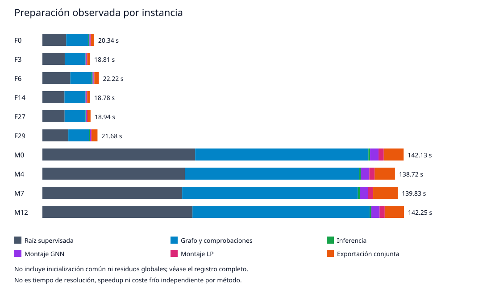

# PR86: guidance reviewed and remaining main-comparison budget

**Author authorization, 12 October 2026:** the author explicitly approved the
210-solve/70-job envelope below, including review of the first group before
remaining dispatch. The original generated budget request stays false; it is
preserved as a request, not rewritten as historical approval. The first-group
operator records a separate hash-bound approval at submission. No job has been
submitted by this code publication.

## What is finished, how it was checked, and why it matters

Job **3521**, source `4209e959021b4e85d11cc5b9726702328462cc94`,
completed in Slurm **407 s**, exit `0:0`. The downloaded original return is
preserved byte for byte, SHA256
`3a78942e349737c916ba717df7110bf867771e85613578a9f2256df2d6ea62f3`.
The original source-tree validator passed before the review code was added.
The pinned offline reviewer checks this immutable return against job3520's
root/model hashes, the mixed checkpoint, ten parents, MINIMIZE and timing
identities. It does not rebuild old source manifests against a newer checkout.

**Result:** ten graph builds and ten frozen forwards, yielding M1/M2 starts
for F0/F3/F6/F14/F27/F29 and M0/M4/M7/M12. Zero abstentions, zero new
optimizations and zero training. M1 and M2 have equal support cardinality and
positive count per parent, not necessarily equal variable IDs. Support is
14,520–14,880 binaries for easy parents and 20,000 for each medium parent.
The partial starts do not fix bounds or supply continuous variables.

This completes the prospective preparation evidence needed for the main
comparison. It does **not** demonstrate solver start acceptance, complete
solution feasibility, improved predictive quality, speedup or independent
generalization. Private starts must still match their hashes when launched.
The original `scientific_reporting_eligible=false` is preserved. This separate
review qualifies only the named preparation observations.

## Measured costs, not inferred speedup

| Job3521 component (ten parents) | Seconds |
| --- | ---: |
| Features: checks, fresh graphs, export/reload | 325.229 |
| Inference including transfers/materialization | 4.189 |
| GNN start assembly | 15.491 |
| LP-matched start assembly | 9.894 |
| Joint private prediction/start export | 41.916 |
| Shared initialization | 3.156 |
| Child residual outside those regions | 4.286 |
| Supervisor residual outside the child | 1.018 |
| **Supervised guidance total** | **405.178** |

Synchronized neural forward time is nested in inference and is not added
again. Combining **287.448 s** of root batch observation (job3520) with
**405.178 s** of guidance supervision gives **692.626 s of instrumented
preparation**. These are two sequential jobs with different measurement
boundaries, not one measured whole-job end-to-end interval. Queueing and
unmeasured outer-stage setup/collection are excluded. Slurm elapsed totals
remain a separate scheduler scope; no attempt is made to force timer equality.

M1 also requires the GNN assembly to obtain its matched support/positive
budget. The prospective cost helper now includes that region. M2 does not
require LP assembly. Existing result bytes are not rewritten. The original
five-region helper remains a **scoped** dependency calculator: supplying its
five inputs does not measure shared setup, joint export or whole-job time.
Its legacy missing-region display is retained only for regeneration of the
old unknown-cost table; that compatibility path refuses numerical cost inputs.

The new ledger keeps all common and residual costs visible and counts them
once for campaign consumption. Its additional sensitivity scenario divides
global overhead equally across ten parents and assigns the full coupled
private export to each guided method separately; M1 additionally includes LP
assembly. These **modeled allocations must not be summed across methods** or
described as measured standalone cold preparation. Dividing by seven is the
planned seven uses per parent/method, not seven completed solves. Future
tables must distinguish observed solver/supervised costs, scoped preparation
dependencies and this explicit allocated-cost scenario. No new preparation
experiment is requested merely to remove that measurement limitation.

Assets: [original return](../evidence/pr86/job3521/public_return.json),
[review](../evidence/pr86/job3521/review.json),
[per-parent table](../evidence/pr86/job3521/preparation_costs.csv),
[manifest](../evidence/pr86/job3521/manifest.json).



Regenerate without Gurobi, GPU or scheduler:

```bash
python -B scripts/evidence/review_pr86_job3521.py \
  --receipt docs/evidence/pr86/job3521/public_return.json --output NEW_DIRECTORY
```

The output directory must be new. Original public bytes, CSV, SVG, review and
budget request regenerate deterministically; the reviewer refuses overwrite.

## Environment and memory

Observed tfm_env: Python 3.10.20, NumPy 1.26.4, Gurobi 13.0.1,
PyTorch 2.1.2+cu121, PyG 2.7.0, V100-SXM2-32GB, driver 550.90.07.
No package upgrade. Sampled job-cgroup peak **4,732,194,816 bytes**;
GPU allocated peak **2,316,073,472 bytes**, reserved peak **2,491,416,576**;
Slurm batch MaxRSS **3359836K**. These are different scopes, not interchangeable
peaks. AllocCPUS=8 reflects Slurm accounting; the preparation requested four
physical cores and one GPU. Inference memory does not qualify future training.

## Next execution decision: main comparison, no more preparation

The [machine-readable request](../evidence/pr86/job3521/remaining_budget_request.json)
freezes the remaining resource envelope against the existing 210-cell matrix
and the two reviewed preparation returns. It is **not approval**, an installed
launch manifest or a submission command. The older proposal's root-job count
is historical: **new root calls = 0; new forwards = 0; training = 0**.

| Main comparison limit | Proposed ceiling |
| --- | --- |
| Parents / methods | Same ten exposed parents / M0, M1, M2 |
| Thread caps at seed 42 | 1, 2, 4, 8, 16: 150 solves |
| Repeats at one thread only | Seeds 43 and 44: 60 solves |
| Total | **210 solves in at most 70 three-method jobs** |
| Gurobi per solve | MINIMIZE; TimeLimit=3600 s; MIPGap=1e-4 |
| Child / job deadlines | 3780 s / 14400 s (4 h) |
| Allocation | One node; 1–16 physical cores matched to thread cap; 64 GiB; no GPU |
| Parallelism | One job and one solver child at a time; shared node |
| Main solver time ceiling | **210 h** |
| Sequential reservation ceiling | **280 h**, excluding queues |
| Physical-core reservation ceiling | **1320 core-hours** |
| Thread-weighted solver capacity ceiling | **990 core-hours**, not measured CPU work |

Memory policy remains solver SoftMemLimit=48 decimal GB, sampled job-scoped
stop=56 GiB and kernel RAM cap <=64 GiB. No requeue, automatic retry, extension
or replacement. Any failed/incomplete group or loss of memory observation
pauses the remaining matrix. A time-limited but valid/censored solve remains
an observation, not an automatic retry. Parameter/model identity must match
within each paired group; scientific promotion requires later result review.

The first frozen group is **F0 / one thread / seed42**, three methods in the
already frozen order. It counts **inside**, not in addition to, the 210 solves.
Review its installed executor/log/cost return before dispatching remaining
groups. This catches integration issues without adding a separate pilot.
Do not interpret approval of the envelope as permission to bypass that gate.

### Implemented first-group operator and boundary

`pr86_main_first_group.py` connects the existing isolated executor and memory
supervisor to the reviewed preparation. It exposes prepare/submit/status/collect
for only F0/1/42. Preparation hashes the installed source/model/root/graph/
predictions/starts without optimizing, importing checkpoints or repeating
inference. It binds the observed Python/NumPy/Gurobi versions. Three separate
admission references bind preparation, environment and resource approval to
the same source, matrix and parent start. The child rechecks them before its
sole optimize call. MINIMIZE and unchanged mathematical signature are required.

A durable first-group claim precedes sbatch and survives ambiguous outcomes
and changed source commits. Submission is held only while its ID and actual
single-node/one-core/64-GiB/four-hour/no-GPU/no-requeue profile are recorded;
the operator releases it automatically once verified. Slurm `1-1` and logical
CPU accounting of 1 or 2 are handled explicitly. There is no polling loop,
resubmit, release retry or overwrite. Failures preserve state and require
inspection, not repetition. Remaining dispatch is hard-blocked in this module.

Collection exports allowlisted JSON members only, with exact bytes and hashes;
no logs, predictions, solutions or private paths are exported. Offline review
reconciles cell identity, paired signatures/parameters, starts, logs' hash
metadata, nested attempt/export timings and scoped preparation costs. A failed
job can export a partial receipt with `ready_for_independent_review=false`
without fabricating completed costs. One scp retrieves the return file with
one password prompt. The receiver never submits work. The CLI is supplied
against the published final source and four successful CI checks.

The exact resource budget is now approved. The next intervention is execution
of the supplied first-group CLI on dgx-dasci. Merge still requires the agreed
intervention; PR86 stays draft until its
comparison/analysis deliverable is complete. PR87's mandatory 1/4-GPU matched
full training has its own budget. PR88's evidence-linked manuscript and the
C–F roadmap to December 2026 are unchanged.
